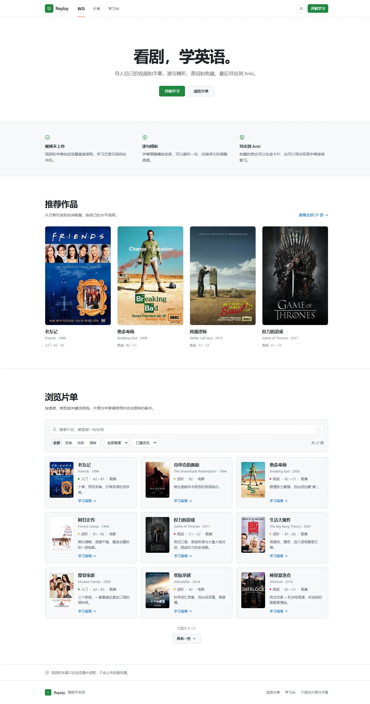
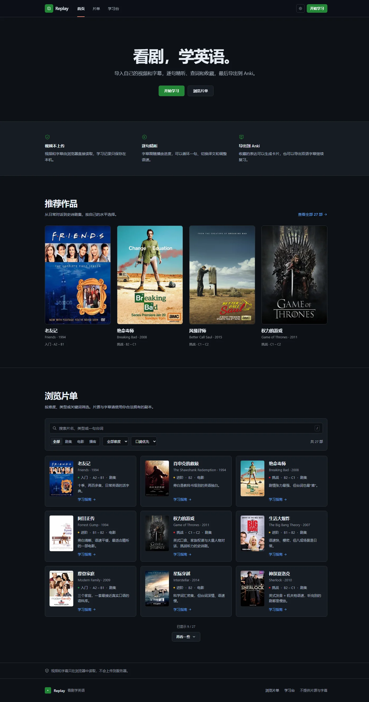
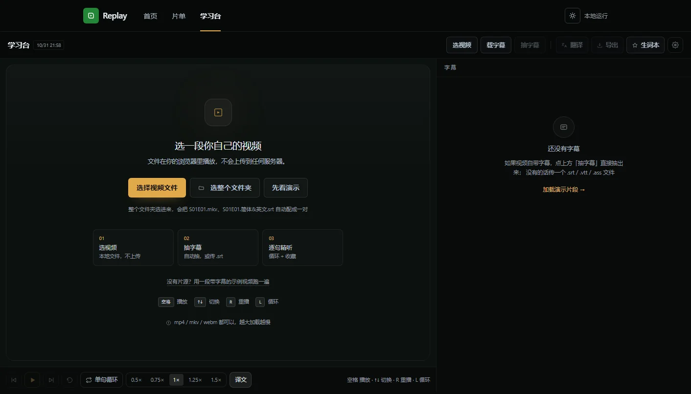
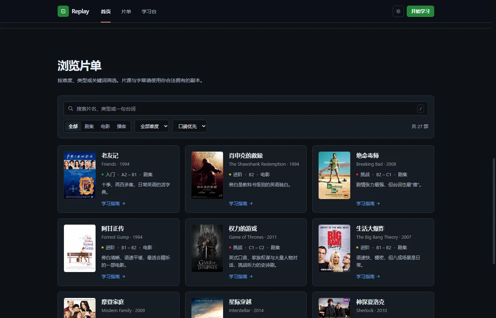
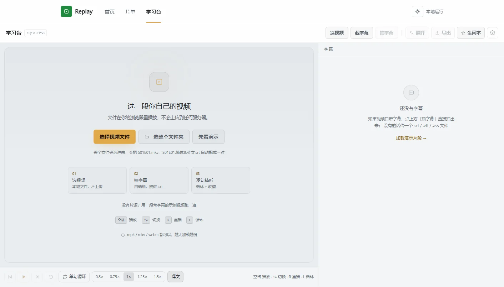
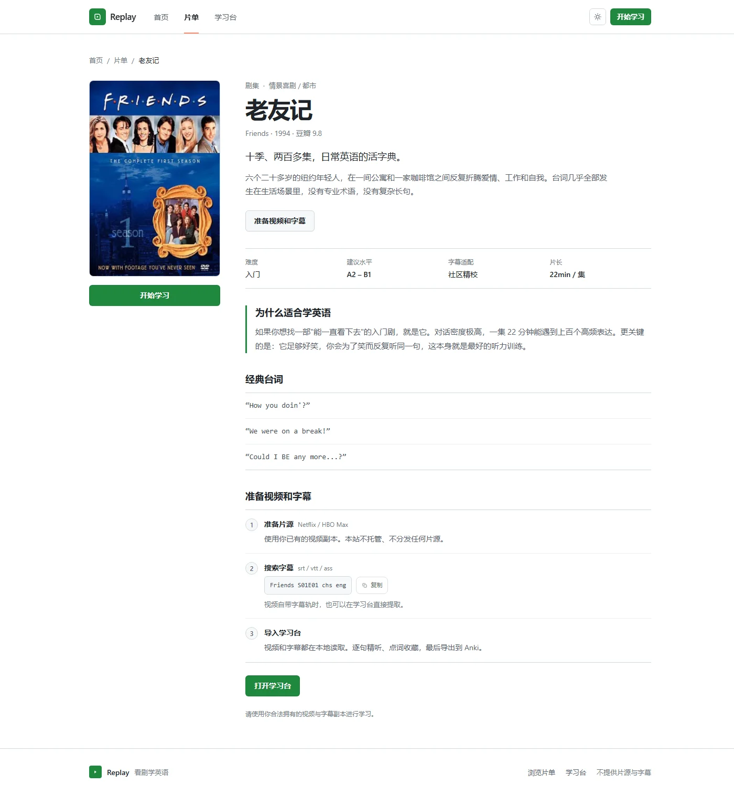
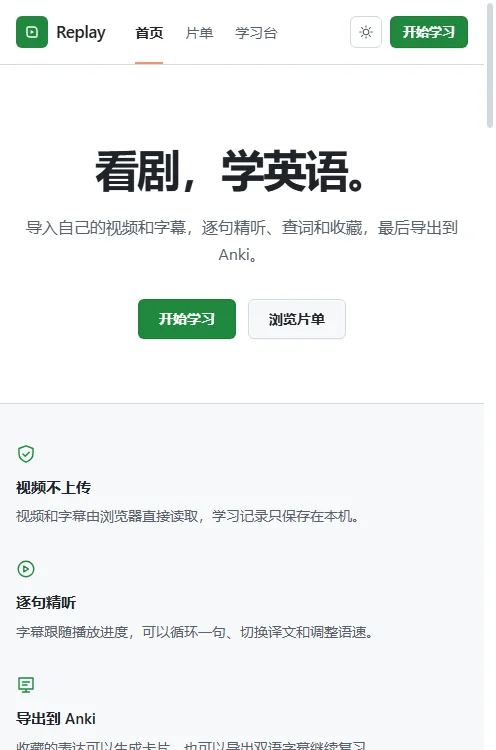

# Replay · 看剧学英语

> 把一部剧，变成一份生词本。

一个**完全本地**的英语学习工具：选一部适合你水平的剧，在浏览器里播放，逐句精听，点词查义，把值得记的表达收进生词本，一键导出 Anki。

**视频不上传，一个字节都不会。**

[](./LICENSE)
[](https://nextjs.org/)
[](https://tailwindcss.com/)



<sub>English: Replay is a local-first English learning player for TV series. It plays your own video files in the browser, syncs bilingual subtitles line by line, looks up words with a bundled ECDICT subset, and exports everything to Anki. No upload, no account, no backend.</sub>

---

## 为什么做这个

市面上的工具分两种：字幕站给你一个 `.srt` 就结束了；词典 App 能查词，但和你正在看的那一集没有关系。

中间是空的：**没有人把「一部剧」变成「一份可以背的生词本」。**

Replay 的三个决定：

1. **视频不上传** —— File API + `URL.createObjectURL`，视频在浏览器播放；最近一次视频与学习状态保存在浏览器本地，退出后可以恢复
2. **不提供片源和字幕** —— 目录只做信息聚合、难度评级、学习建议
3. **数据跟着你走** —— 生词存 localStorage，导出 CSV 直接进 Anki

---

## 功能

### 导入

| 方式 | 说明 |
|---|---|
| 单个视频 | 拖进来或选文件，本地解码播放 |
| 单个字幕 | `.srt` / `.vtt` / `.ass` / `.ssa`，按内容识别格式，不靠扩展名 |
| 整个剧集文件夹 | 选一个目录，自动把 `S01E01.mkv` 和 `S01E01.简体&英文.srt` 配成一对 |
| 从视频抽字幕 | 视频带字幕轨时，ffmpeg.wasm 在浏览器里抽出来 |
| 内置下载器 | 在 `/download` 直接输入链接、解析、下载并分离字幕，再一起导入 MP4 和 SRT |
| 演示数据 | 没有片源也能走完整流程 |

### 下载视频并学习

先按 [桌面工具说明](services/video-downloader/README.md) 安装依赖并启动本机服务，再打开 [下载页](https://www.replayen.com/download)。链接输入、解析结果、下载进度和记录直接显示在 Replay 页面中，跟随网站主题，不需要弹出独立工具窗口。下载记录中的「导入 Replay 学习」会把视频和配套字幕一起送到学习台；也可以选择已经保存的 MP4 和 SRT 一起导入。

内置区域使用 credentialless iframe 连接本机服务，API 仍只接受本机同源请求。父页面与内置区域通过固定来源、窗口和一次性令牌校验消息，同步主题与内容高度；下载文件通过 File 对象传递，不上传。临时 IndexedDB 副本有效期 15 分钟，成功载入学习台后删除；过期副本在下一次导入前清理。进入学习台时完整导航，以恢复抽字幕所需的浏览器隔离。独立桌面工具的导入方式也继续支持。

现成双语字幕优先；独立中英文 SRT 只有在每句起止时间完全一致时才合并，其他情况保留原字幕供切换。自动分离支持文本软字幕，画面硬字幕和图片字幕不能直接转换为 SRT。

当前下载需要电脑运行本机工具。手机可导入已传到手机的 MP4/SRT，网站尚未提供公共云端下载任务。

### 精听

- **时间轴同步**：播到哪句，右侧亮哪句、滚到哪句
- **画面字幕**：视频上叠加字幕，切句时淡入上浮
- **独立滚动**：手动滚动即暂停跟随，点「回到第 N 句」接回来
- **单句循环 / 变速**：0.5× – 1.5×，一句没听懂可以反复播
- **译文开关**：先裸听，再对答案
- **键盘流**：`空格` 播放 · `↑↓` 切句 · `R` 重播 · `L` 循环

### 查词与翻译

点字幕里任意一个单词：音标、浏览器 TTS 朗读、中文释义、原句高亮、一键收藏。

词典是 [ECDICT](https://github.com/skywind3000/ECDICT) 的高频子集：**11352 个词条 + 15843 条词形映射**，所以 `went` 能查到 `go`，`robberies` 能查到 `robbery`。

翻译接任意 OpenAI 兼容接口（DeepSeek / OpenAI / Moonshot…），Key 只存在你自己的 localStorage：

- 32 条一批、4 批并发，2260 句从 7.5 分钟压到 1 分钟左右
- 跳过 `[music continues]` 这类音效行（实测占 53%，纯烧 token）
- 按内容指纹缓存，同一份字幕第二次导入零请求
- 每批落盘，翻到一半关页面也不丢

### 带走

Anki 卡片（正面英文、背面译文与重点词）、双语 `.srt` / `.vtt`、独立生词本。同一份字幕再打开会问「上次看到 12:34，接着看？」。

### 退出后继续学习

最近一次视频、字幕（含译文）、播放位置、单句循环、语速和译文开关保存在当前浏览器。离开学习台、刷新或重新打开后自动恢复，保持暂停，点击播放即可继续。视频缓存只保留最近一份，换视频时释放旧缓存；「清除记录」可清理本次视频、字幕与进度，保留生词本和电脑中的原文件。

缓存使用本机 IndexedDB，不上传视频或学习内容。浏览器空间不足时保留字幕与进度，并提示下次重新选择原视频；缓存受浏览器存储策略影响，清除网站数据、无痕窗口关闭或更换浏览器后需要重新导入。具体实现与验收见 [学习恢复说明](docs/learning-session.md)。

### 主题

浅色 / 深色双主题，右上角切换，跟随系统偏好，刷新不闪。学习台与站点共用一套设计令牌。

---

## 截图

| 首页 · 深色 | 学习台 · 深色 |
|---|---|
|  |  |

| 片单 · 深色 | 学习台 · 浅色 |
|---|---|
|  |  |

| 作品详情 · 浅色 | 移动端 · 浅色 |
|---|---|
|  |  |

---

## 快速开始

需要 Node.js **18.17+**（推荐 20，见 `.nvmrc`）。

```bash
git clone https://github.com/3121597355/replay.git
cd replay
npm ci
npm run dev      # http://localhost:4310
```

生产构建：

```bash
npm run build
npm start
```

不需要后端、数据库、账户。想用翻译功能，点右上角齿轮填一个 API Key 即可（默认指向 DeepSeek，可改成任意兼容接口）。

> 「示例片段」加载 `public/sample/manchester-repair-v2.mp4` 和配套 `.srt`。
> 片段取自《海边的曼彻斯特》的维修对话，约 39 秒；视频与字幕来自同一版本，按同一个起点截取。
> 商用或公开运营前请替换为你拥有权利的素材，说明见 [THIRD-PARTY-NOTICES.md](./THIRD-PARTY-NOTICES.md)。

---

## 部署

推荐 **Vercel**：导入仓库 → 框架自动识别为 Next.js → 直接部署，无需环境变量。

**为什么不能直接丢到 GitHub Pages**：抽字幕用的 ffmpeg.wasm 依赖 `SharedArrayBuffer`，
浏览器要求页面处于跨域隔离状态，也就是响应头里必须有：

```
Cross-Origin-Opener-Policy: same-origin
Cross-Origin-Embedder-Policy: credentialless
```

这两行已经写在 `next.config.mjs` 的 `headers()` 里，Vercel / 自建 Node 服务会照常下发。
纯静态托管（GitHub Pages、对象存储）加不了响应头，抽字幕会失败，
其它功能（播放、字幕、查词、导出）不受影响。

其它平台（如 Netlify / Cloudflare Pages）请把上面两条响应头加到平台配置里。

---

## 项目结构

```
app/
  page.tsx              首页：主张、推荐作品、片单
  movie/[slug]/page.tsx 作品详情：难度、学习建议、开始学习
  learn/page.tsx        学习台：播放器、字幕、查词、翻译、导出
  globals.css           设计令牌（浅色 / 深色）与基础样式
components/
  Nav.tsx  ThemeToggle.tsx  Catalog.tsx  MovieCard.tsx  Poster.tsx
lib/
  data.ts               27 部作品的元数据
  subtitle.ts           字幕解析（srt / vtt / ass / mov_text）
  pairing.ts            剧集与字幕文件配对
  dict.ts               本地词典与词形还原
  translate.ts          OpenAI 兼容翻译、分批、缓存
scripts/                测试与诊断脚本（见下）
public/
  posters/              作品封面
  dict/                 由 ECDICT 生成的高频词典
  sample/               演示片段
```

---

## 技术要点

| 问题 | 做法 |
|---|---|
| 没有 ffprobe 怎么找字幕轨 | 跑 `ffmpeg -i`，解析 stderr 里的 `Stream #0:N: Subtitle: xxx`；>300 MB 走 `WORKERFS` 挂载 |
| mp4 能不能抽字幕 | 能，前提是真有软字幕轨（`mov_text`）；硬字幕给明确诊断而不是让你猜 |
| 为什么不做硬字幕 OCR | 用户找 srt 只要 5 秒，OCR 要半小时，成本全在用户那边 |
| 翻译慢在哪 | 不是模型慢，是串行 + 全量发：跳音效、加大批次、并发、内容指纹缓存 |
| 查词的真难点 | 词形还原（`went → go`），三层降级：lemma 表 → 规则 → 如实说没收录 |
| 单句循环 | 监听 `timeupdate`，越过 `cue.end` 就把 `currentTime` 拨回去，不用 ffmpeg 切片 |
| 剧集配对 | 先剥掉 `.简体&英文` / `.chs` / `.双语` 这类语言后缀，同一集才能落到一个键上 |

<details>
<summary>展开：几个实现细节</summary>

**字幕轨探测的正则**，对 mkv 的 `subrip` / `ass` 和 mp4 的 `mov_text` 都管用：

```ts
/Stream #0:(\d+)(?:\[0x[0-9a-fA-F]+\])?(?:\(([^)]+)\))?: Subtitle: ([a-zA-Z0-9_]+)/g
```

**单句循环**没有 ffmpeg 参与，零成本零延迟：

```ts
if (loop && currentCue && video.currentTime >= currentCue.end) {
  video.currentTime = currentCue.start;
}
```

**单词高亮**用 `mark.w` 包裹字幕里的目标词，配合 `cue-active` 做当前句的呼吸背景，
切句动画只用 `opacity + translateY`，避免整页重排。

</details>

---

## 测试与脚本

```bash
npm run typecheck                     # tsc --noEmit

npx tsx scripts/test-pairing.ts       # 剧集配对，46 条断言
npx tsx scripts/test-srt-export.ts    # 双语字幕导出，17 条断言
npx tsx scripts/test-parse.ts         # 真实字幕解析（需要本地样本，见脚本内路径）
```

界面相关的诊断脚本走 CDP 连 headless 浏览器，需要本机有 Chrome / Edge：

```bash
npm run shots -- http://127.0.0.1:4310/ docs/shot.webp 1440 900
node scripts/check-images.mjs http://127.0.0.1:4310/     # 检查图片是否都真的加载
node scripts/diag-layout.mjs                              # 各区块高度、能否滚动
```

浏览器路径通过 `BROWSER_PATH` 指定，未设置时按平台常见路径自动探测：

```bash
BROWSER_PATH=/Applications/Google\ Chrome.app/Contents/MacOS/Google\ Chrome npm run shots -- ...
```

重新生成词典（需要自行下载 ECDICT 到 `_dict/`，66 MB，不随仓库分发）：

```bash
npm run dict
```

---

## 边界

- 本站**不提供、不存储、不分发任何片源与字幕**，播放的是你自己选择的本地文件
- 视频与字幕只在浏览器里读取，不会上传到任何服务器
- 生词、设置、续播进度都存在 localStorage，换设备不会同步

### 关于版权素材

仓库里的剧集海报与演示片段**仅用于功能演示**，版权归各制作方所有，不在 MIT 许可范围内。
公开运营前请替换为已获授权的素材。完整说明见 [THIRD-PARTY-NOTICES.md](./THIRD-PARTY-NOTICES.md)。

---

## License

代码使用 [MIT License](./LICENSE)。第三方素材、词典数据、剧名与商标不在此许可范围内。
